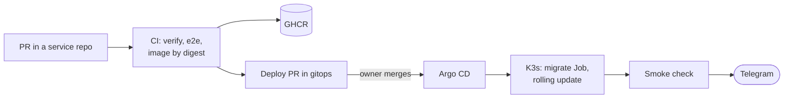
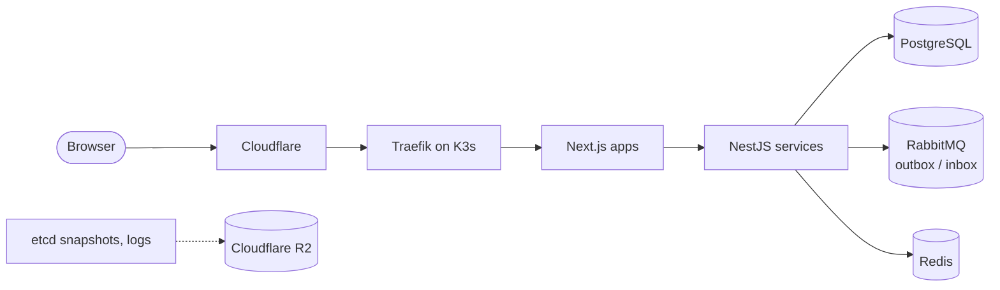

# nick-lukashik

**The platform behind [nick-lukashik.com](https://nick-lukashik.com): designed, built and operated end to end by one engineer, from the page to the cluster.**

---

## What this is

A personal site and the platform its services run on, built in the open. One VPS with K3s behind Cloudflare, every change in git, every deploy a reviewed pull request. The site, sign-in, notifications, a coin wallet and a daily digest run as separate services on the same platform; payments are built and not deployed yet.

## How a change reaches production

## Engineering highlights

- **One contract for every service.** Port, user, read-only root filesystem, probes, request limits, time budgets and degradation are written down once in the [service runtime contract](https://github.com/nick-lukashik/.github/blob/master/docs/service-contract.md) and enforced by the [gitops](https://github.com/nick-lukashik/gitops) components and the [reusable CI](https://github.com/nick-lukashik/.github/blob/master/docs/ci.md).
- **Deploys you can review.** One image per commit, deployed by digest. CI opens the deploy PR with the commit list; the owner's merge is the deploy; a rollback is a revert. Branch rules on `gitops` let no bot or app merge by itself.
- **Closed by default.** The server answers only Cloudflare, with Authenticated Origin Pulls; SSH and the Kubernetes API are reachable only over Tailscale. Default-deny network policies in `prod`, restricted Pod Security, Sealed Secrets in git, secrets in Bitwarden and never on screen.
- **Starters with only what a service needs.** [nest-starter](https://github.com/nick-lukashik/nest-starter) and [next-starter](https://github.com/nick-lukashik/next-starter) are the minimal templates; [nest-example](https://github.com/nick-lukashik/nest-example) and [next-example](https://github.com/nick-lukashik/next-example) hold every capability tested together: transactional outbox and idempotent inbox on RabbitMQ, pg-boss jobs, a Redis cache that degrades, a streamed and bounded API proxy.
- **Operated, not just deployed.** Prometheus, Grafana, Loki with Alloy; alerts with unit tests and a [runbook section each](https://github.com/nick-lukashik/gitops/blob/master/docs/runbook/alerts.md), sent to Telegram; a dead-man's switch on Healthchecks; etcd snapshots and logs in R2.
- **Checked before it lands.** Kubeconform, alert unit tests, Terraform tests, Testcontainers against real PostgreSQL, Redis and RabbitMQ, Playwright with axe accessibility checks.

## Repositories

| Repository | |
|---|---|
| **[landing-web](https://github.com/nick-lukashik/landing-web)** | the site on nick-lukashik.com |
| **[id-web](https://github.com/nick-lukashik/id-web)** · **[id-api](https://github.com/nick-lukashik/id-api)** | sign-in and the account: email code, Google, passkeys, sessions, tokens |
| **[notifications-api](https://github.com/nick-lukashik/notifications-api)** · **[wallet-api](https://github.com/nick-lukashik/wallet-api)** | email and the in-app inbox; the coin wallet and its append-only ledger |
| **[pay-api](https://github.com/nick-lukashik/pay-api)** | coin packs, checkout, provider webhooks; not deployed yet |
| **[digests](https://github.com/nick-lukashik/digests)** | a daily digest of Google Analytics in Telegram: a CronJob |
| **[packages](https://github.com/nick-lukashik/packages)** | shared `@nick-lukashik/auth` and `@nick-lukashik/contracts` |
| **[gitops](https://github.com/nick-lukashik/gitops)** | desired state of the cluster: Argo CD, the platform, monitoring, the services |
| **[.github](https://github.com/nick-lukashik/.github)** | reusable workflows (build, deploy PR, smoke), the service contract, this profile |
| **[next-starter](https://github.com/nick-lukashik/next-starter)** · **[nest-starter](https://github.com/nick-lukashik/nest-starter)** | templates of a new site and a new API |
| **[next-example](https://github.com/nick-lukashik/next-example)** · **[nest-example](https://github.com/nick-lukashik/nest-example)** | full references: every capability wired and tested |

The Terraform for Cloudflare and GitHub and the server setup live in a private repository.

## Stack

**Frontend**: Next.js 16 · React 19 · TypeScript 7 · Tailwind CSS 4 · shadcn/ui · TanStack Query 5 · next-intl 
**Backend**: Node.js 26 · NestJS 12 · Zod 4 · Drizzle ORM · pg-boss · Pino 
**Data and messaging**: PostgreSQL 18 · Redis 8 · RabbitMQ 4 · Cloudflare R2 
**Infrastructure**: K3s · Traefik · cert-manager · Argo CD · Sealed Secrets · GitHub Actions · Terraform · Cloudflare · Tailscale 
**Observability**: Prometheus · Grafana · Loki and Alloy · Alertmanager to Telegram 
**Quality**: Vitest · Testcontainers · Playwright · axe-core · Biome · pnpm · Renovate

## Built by

**Nick Lukashik**, senior full-stack engineer.

